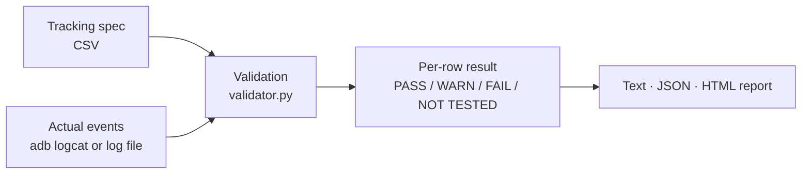

# Tracking Validator Demo

Validate Android tracking events from logcat against a tracking spec, row by row.

**[View the demo report](https://buikhanh99.github.io/tracking-demo/)** · [Back to portfolio](https://buikhanh99.github.io/#cs-01)

> **What this is.** A public demo with fake data for a made-up fitness app. It re-implements the validation idea behind the Auto Tracking Test dashboard I built for work (CS-01 in my portfolio). It is **not** that tool's source code and contains no company data. The internal tool also mirrors the device screen and syncs the spec from Lark; this demo covers only the validation logic.

## Why

Tracking specs run to hundreds of rows: event name, the screen or button that fires it, parameter names and allowed values. Checking each event against the sheet by reading raw logcat is slow, and parameter mismatches are easy to miss. The validator reads the log, matches every event to its spec row and reports PASS / WARN / FAIL per row, plus what was never fired.

## How it works



1. **Load the spec.** One CSV line per parameter; lines with the same `row_id` form one spec row.
2. **Read the log.** Only lines with the `TrackingEvent` tag are used. The payload is JSON: `{"event": "...", "params": {...}}`.
3. **Match.** Each event goes to the most specific spec row whose event name and `match` parameters fit (for example `button_click` with `button_name=subscribe`).
4. **Check** every parameter of that row, then report.

## Run it

Python 3 standard library only, nothing to install. Tested with Python 3.14.

```bash
python3 validator.py --spec spec/sample_tracking_spec.csv --log logs/sample_session.log --html index.html --json result.json
```

Live from a connected device, assuming the app logs tracking events as JSON under the `TrackingEvent` tag. Press Ctrl+C to stop; the report still covers everything read so far.

```bash
adb logcat -v threadtime -s TrackingEvent:I | python3 validator.py --spec spec/sample_tracking_spec.csv --log - --html report.html
```

The exit code is `1` when any row fails, so the same command can gate a CI job.

## Spec format

[`spec/sample_tracking_spec.csv`](spec/sample_tracking_spec.csv)

| Column | Meaning |
|---|---|
| `row_id` | Spec row. Repeat it on several lines to list several params. |
| `feature`, `trigger` | Where and when the event should fire, for people reading the report. |
| `event` | Event name. |
| `match` | Optional `key=value` pairs (separated by `;`) that tell rows of the same event apart. |
| `param`, `type` | Parameter name and type: `string`, `int`, `number`, `bool`. |
| `required` | `yes` or `no`. |
| `allowed` | `a\|b\|c` for a list, `1..5` / `0..` / `..10` for a range, empty for anything. |

## Validation rules

| Check | Result |
|---|---|
| Required parameter missing | FAIL |
| Wrong type (e.g. `"4.99"` where a number is expected; `true` is not an int) | FAIL |
| Value not in the allowed list | FAIL |
| Number outside the allowed range | FAIL |
| Parameter that is not in the spec | WARN |
| Event or variant with no spec row | Listed as unknown |
| Tagged line whose payload is not valid JSON | Listed as a parse error |
| Spec row never fired in the session | NOT TESTED |

A row fails if any of its occurrences fails, warns if any warns, and passes only if every occurrence passes.

## Sample result

The sample log is one short session written to hit every rule at least once.

| | Rows |
|---|---|
| PASS | 3 (R02 Home, R03 Paywall view, R07 Workout) |
| WARN | 1 (R04 extra `experiment` param) |
| FAIL | 4 (R01 `open_from="default"`, R05 price sent as a string, R06 missing `value_micros`, R08 `stars=6`) |
| NOT TESTED | 2 (R09, R10 never fired) |
| Unknown | 1 (`debug_ping`) |
| Parse error | 1 (truncated JSON) |

R01 shows why results are per row and not per event: the first `app_open` passes, the second sends `open_from="default"`, so the row fails.

## Tests

```bash
python3 -m unittest discover -s tests -v
```

20 tests cover each rule, the type edge cases (`bool` is not accepted as `int`, `int` is accepted as `number`), range bounds, row matching, noise and malformed lines, stdin input, the sample session totals and the exit code.

## Limitations

- **Coverage is session coverage.** Only rows the session triggers are validated; everything else is reported as NOT TESTED, not as passing.
- **The log format is an assumption.** The app must log one JSON payload per line under one tag. Other formats need a different parser.
- **No ordering or timing rules.** It does not check that event A fires before event B, or within N seconds of a tap.
- **Exact matching only.** Free-text values typed by users, or values that depend on context (such as a price from the store), need manual review or a looser rule.
- **The spec is trusted.** If the spec is wrong or out of date, the result is too.

## Files

```
tracking-demo/
├── validator.py                    # the validator (text, JSON and HTML output)
├── spec/sample_tracking_spec.csv   # fake spec, 10 rows
├── logs/sample_session.log         # fake logcat session
├── tests/test_validator.py         # unit tests
└── index.html                      # report generated from the sample session
```
